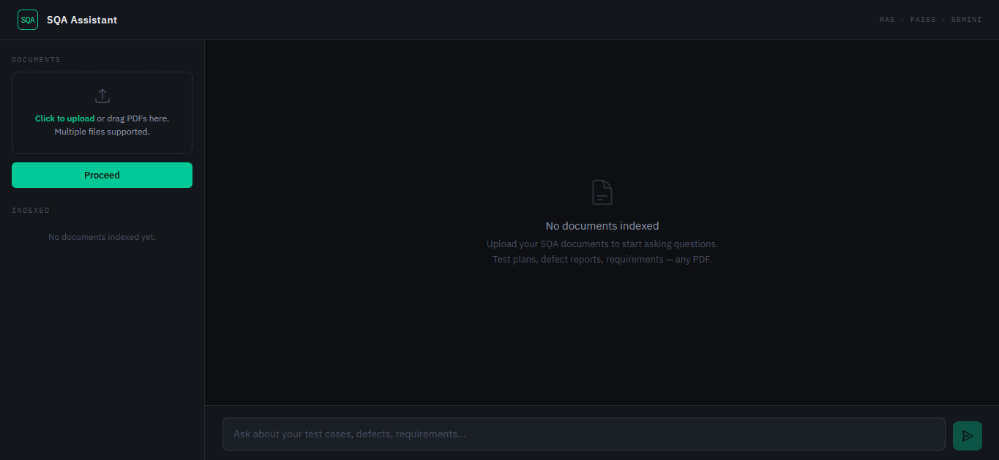

# SQA Assistant

A RAG application for software quality assurance professionals.
Upload test plans, defect reports, and requirements specs, then ask questions
in plain English, get answers with source citations.

Built to solve one real problem: SQA teams spend hours searching through
PDFs manually. This assistant retrieves the right passage, tells you which
document and page it came from, and refuses to answer when the context
is not there.




---

## What it does

SQA professionals spend hours searching through PDFs for answers:
"which test cases cover the login module?", "what is the severity of
this known defect?", "does our test plan address performance requirements?".
This assistant answers those questions instantly, with citations.

Upload multiple documents. Ask anything. Get answers with exact source and page number.

---

## How it works

```
PDF upload
     |
     v
Docling -- layout-aware parsing (headings, tables, sections preserved)
     |
     v
HybridChunker -- structure-aware chunks with bge tokenizer
     |
     v
BAAI/bge-small-en-v1.5 -- normalized embeddings
(document title prepended to each chunk before embedding)
     |
     v
ChromaDB -- persistent vector store (cosine similarity)
     |
  question
     |
     v
same bge model embeds the question
     |
     v
cosine distance search -> top 3 chunks
     |
     v
confidence filter -- LOW confidence dropped
(distance < 0.2 = HIGH, < 0.5 = MEDIUM, else dropped)
     |
     v
title stripped -> clean context fed to Gemini
     |
     v
answer + source filename + page number
```

The LLM is instructed to refuse answering outside the uploaded context.
If confidence is too low, the system returns "insufficient context"
rather than hallucinate.

---

## From 40% to 80% -- What Actually Changed

Early builds answered roughly 40% of queries correctly.
The rest hit the confidence floor and returned "insufficient context"
even when the answer was sitting in the document.

Two decisions moved the needle:

**1. PyPDF to Docling (40% to 55%)**
PyPDF treats every PDF as a flat stream of text. Docling understands
layout -- headings, tables, and sections stay intact. SQA documents are
structure-heavy, so this mattered immediately.

**2. all-MiniLM to BAAI/bge-small-en-v1.5 (55% to 80%)**
BGE is trained specifically for retrieval tasks with normalized embeddings.
The cosine distances became meaningfully tighter on relevant chunks,
which meant fewer false negatives at the confidence threshold.

*Accuracy measured informally -- percentage of test queries returning a
grounded answer across roughly 30 manual queries during development.
Not a formal eval.*

---

## Tech stack

| Layer | Technology | Why |
|---|---|---|
| PDF parsing | Docling | Layout-aware -- preserves headings, tables, and sections |
| Chunking | Docling HybridChunker | Structure-aware chunks, not arbitrary token splits |
| Embedding | BAAI/bge-small-en-v1.5 | Trained for retrieval, normalized cosine embeddings |
| Vector store | ChromaDB | Persistent across uploads, no rebuild on restart |
| API | FastAPI + Pydantic | Auto-validation, interactive docs at `/docs` |
| LLM | Gemini Flash | Free tier, no GPU -- LLM role here is synthesis not retrieval |
| Frontend | Vanilla HTML/CSS/JS | Zero dependencies, instant load |

---

## Project structure

```
document-qa-assistant/
├── app/
│   ├── api.py          # FastAPI -- /api/ask and /api/upload endpoints
│   ├── main.py         # App entry point, lifespan, CORS, model loading
│   ├── models.py       # Pydantic request and response schemas
│   ├── rag.py          # Full RAG pipeline -- parse, chunk, embed, retrieve, prompt
│   ├── state.py        # Shared pipeline state and directory paths
│   └── __init__.py
├── data/
│   ├── sample/         # Sample SQA documents for testing
│   └── uploads/        # Uploaded documents stored here
├── public/
│   └── index.html      # Single-file UI -- upload panel, chat, source citations
├── tests/
├── requirements.txt
└── README.md
```

---

## Getting started

### Prerequisites

- Python 3.10+
- Gemini API key -- free at [aistudio.google.com](https://aistudio.google.com)

### Install

```bash
git clone https://github.com/mxms-IP/sqa-assistant.git
cd sqa-assistant

python -m venv .venv
source .venv/bin/activate       # Windows: .venv\Scripts\activate

pip install -r requirements.txt
```

### Configure

Create a `.env` file in the project root:

```
GEMINI_API_KEY=your_key_here
```

### Run

```bash
uvicorn app.main:app --reload
```

Open `http://localhost:8000/home` in your browser.
Interactive API docs at `http://localhost:8000/docs`.

---

## API

### `POST /api/upload`

Upload one or more PDF files. Parses, chunks, embeds, and stores in ChromaDB.

```bash
curl -X POST http://localhost:8000/api/upload \
  -F "files=@testplan.pdf" \
  -F "files=@defects.pdf"
```

### `POST /api/ask`

Ask a question against all indexed documents.

```bash
curl -X POST http://localhost:8000/api/ask \
  -H "Content-Type: application/json" \
  -d '{"question": "Which test cases cover the authentication module?"}'
```

Response:
```json
{
  "answer": "Test cases TC-014 through TC-019 cover the authentication module...",
  "metadata": [
    { "source": "testplan.pdf", "page": 4 }
  ]
}
```

Full schema available at `/docs`.

---

## Author

**[mxms-IP](https://github.com/mxms-IP)**